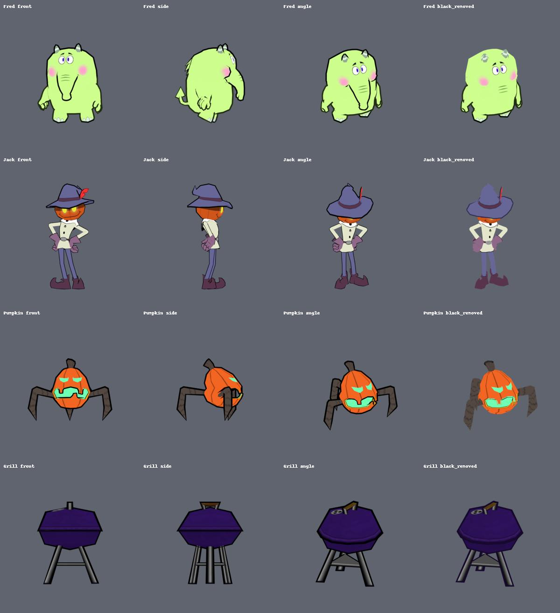
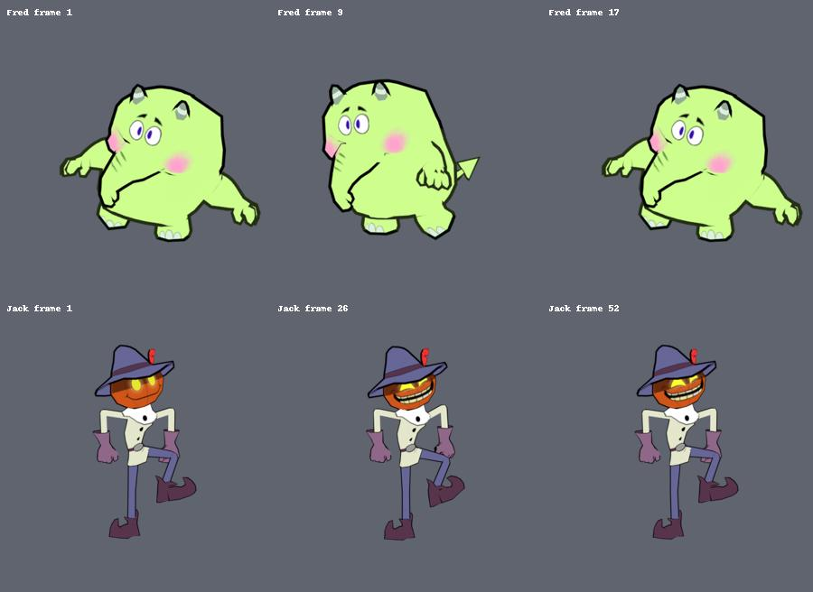

# Style Bible v1.0 — 2026-11-14

## Status and evidence

Persistent baseline derived independently from four actual reconstructed source assets, geometry/material/texture inspection, new orthographic renders, six movement samples, source shader text and controlled recoloring. Earlier AI prose served only as a locator. This is not human aesthetic approval or pixel-identical PS2 validation. **O** means observed in files/renders; **I** interpretation; **P** new production choice; **U** unresolved. Reconstructed shaders are not direct proof of the game's renderer.

Columns: front, side, oblique, same oblique view with near-black vertex colors changed to white. Images normalize apparent size, not canonical physical scale. Character front is +X in these reconstructed scenes; new assets use -Y. Older preview names are not evidence of orientation.

## Recognizable identity

**O:** Broad colored volumes sit inside strong dark, visibly polygonal boundaries. Large identifying shapes dominate small detail: Fred's body/trunk, Jack's brim/long shins/large shoes, Pumpkin's angular spread legs, Grill's oversized bowl/splayed stand. The silhouettes differ greatly; a shared hierarchy of a few masses and graphic edges connects them.

**O:** Colors are not uniformly bright or flat. Fred has a bright body with soft cheeks; Jack has muted clothes and an orange face; Pumpkin combines intense orange/mint with mottled brown legs; Grill has purple gradients, grey highlights and a wood-like handle. A blanket rule forbidding gradients or demanding primary colors contradicts the evidence.

**I:** Selective simplification is the transferable principle: exaggerate identifying construction, spend detail at identity and articulation, keep other regions quiet. Dark boundaries separate masses; broad tonal variation can suggest volume without realistic surface response.

## Measurements, not universal budgets

Counts in `assets/references/measurements.json` include existing ink/detail geometry and packet vertex duplication.

| Subset | Parts | Vertices | Triangles | Textures | Near-black corners / all color entries |
|---|---:|---:|---:|---|---:|
| Fred base | 26 | 2299 | 2953 | 128² body, 256² face | 1908 / 8859 |
| Jack base, excluding H/V | 28 | 3266 | 3222 | 128² body, 256² face | 4887 / 9666 |
| Pumpkin PmpknLa | 7 | 1377 | 966 | 64² | 1431 / 2898 |
| GrillO | 1 | 224 | 204 | 64² | 315 / 612 |

Near black = max linear RGB < .01, an intervention selector, not a palette requirement or outline polygon percentage. Corner counts are not screen coverage. Sampled world width/height is roughly .87 for Fred and .43 for Jack: evidence against one body-proportion template, not a canonical relative-height claim. Bounds vary with pose and recovered scale.

**P:** Begin a prop with the fewest segments that preserve its silhouette and a small atlas. The proof uses 128² and 260 triangles including ink. These are example choices. The observed 64–256² range is historical, not a hard cap; add resolution for actual close views and topology for deformation while retaining quiet visual detail. Do not preserve duplicated packet vertices or enforce a universal triangle count.

## Shape language and modeling

**O:** Fred's round body retains straight silhouette segments. Jack contrasts thin limbs with wide hat, gloves and shoes. Pumpkin's legs are tapered strips with broad angular bends. Grill is comparatively regular and symmetric: asymmetry is not mandatory.

**P — characters:** Establish mass distribution and silhouette before anatomical detail. Use deliberate width changes, real side-profile volume and clear articulation. Provide depth for hands, hats and protrusions; these references are not flat cutouts. Place detail where it communicates identity. Provide joint loops for actual motion without defaulting to realistic musculature.

**P — props:** Make the operating part identifiable before adding hardware. A large body on sparse supports is useful in Grill and the proof, but not compulsory for every prop. Small hinges, slots and vents should be readable punctuation. Avoid precision-machined detail density unless intentionally requested.

**P — environments:** Apply large-mass hierarchy and selective detail provisionally. One inspected grill cannot establish terrain, architecture, foliage or full arena composition. Gather a relevant level reference for a major environment request; do not label untested environmental conventions as recovered facts.

## Ink and internal marks

**O:** All four contain near-black vertex colors. Recoloring only those entries removes much of the silhouette and internal separation while leaving texture, camera and geometry fixed. Some interior marks remain. Thus the reconstructed ink is neither solely a screen postprocess nor solely texture drawing.

**O:** Reconstruction nodes use emission, texture/attribute operations and backface handling. Source Grill material says `SingleSided`, `GouraudShade`, `ColorModulate`, `AlphaDecal`; Jack source shader specifies bilinear sampling and separate face coordinate transforms. These support sidedness and modulation, but do not recover a complete lighting equation or a specific shell extrusion algorithm.

**I:** Geometry supplies camera-dependent boundaries, textures supply other interior graphics. The intervention alone does not prove every black triangle is a duplicate expanded hull; some may be deliberate strips/patches.

**P:** For new closed volumes use an expanded, reversed-winding, black single-sided shell. Use texture strokes or separate geometry for internal marks. Name roles explicitly. A two-sided black hull can obscure the entire colored body. For open cloth, intersections or thin planes, selectively design edges instead of blindly applying the shell helper.

**P:** Compare line weight at matched screen size. Proof revision 1 (.005–.012 m shells) looked too thin beside Grill and Pumpkin; revision 2 uses .008–.028 m according to part. This is a visual correction for a roughly 1.96 m object at the supplied camera, not a universal metre/pixel standard. Preserve necessary holes and gaps; excessive ink can close finger, eye or slot separation.

## Color, material and texture

**O:** Reconstructed atlases use linear filtering; Jack source explicitly says `Bilinear`. Nearest-neighbor pixelation is not the default. The atlases contain both broad fills and selected surface/facial detail. Fred and Jack face sheets supply expressions without high-resolution facial sculpting.

**P:** Arrange a dominant region, contrasting functional/face region and restrained accents as useful starting relationships, not an exact required color count. Muted cream/purple coexist with orange/green in the sample. Fred's green is character-specific, not a global palette. Evaluate at thumbnail size.

**P:** Allow broad painted variation that clarifies material/form, as Grill does. Avoid photographic microdetail, fine roughness noise, dense normal maps and pervasive metallic highlights in the baseline. Painted highlights are different from strong moving reflections. Soft cheek marks are an observed exception to hard texture boundaries.

**P:** Reusable baseline material: texture × optional vertex color → emission, plus explicit backface transparency in Blender. This reproduces the inspected reconstructions' lighting-independent behavior, not necessarily the PS2 lighting model. Color textures are sRGB; perform multiplication in the shader's linear working space. Add atlas gutters as a modern production improvement and inspect filtering at distance.

## Camera and rendering

**O:** Jack's brim hides eyes from elevated/back views; Fred's trunk becomes prominent in profile. These are camera-dependent 3D overlaps, not proven billboards or a guarantee that faces always remain frontal.

**P:** Diagnostic boards use matched apparent size, orthographic views, Standard transform, exposure 0, gamma 1 and transparent images over the same neutral background. This is a reproducible review setup, not the original game camera. Also inspect the actual intended perspective/gameplay distance. Do not distort every view to look frontal.

**U:** Original gamma, lighting, blending, FOV and effects remain unverified against gameplay. `SpecularColor` text does not by itself prove visible specular response. Do not present added realistic rim lighting as recovered evidence.

## Animation and deformation

**O:** Newly rendered Fred `PS2_mvNorm` frames 1/9/17 retain the dominant body while arms/legs separate. Jack `Jack_mvNorm` frames 1/26/52 preserve hat/shoe recognition through limb motion and change mouth appearance. These six samples demonstrate review criteria, not complete animation/contact/interpolation validation. Face source transforms and scene UV drivers support expression-state switching; not every character necessarily uses the same mechanism.

**P:** Review extremes of actual motion, not only rest pose. Match weights between colored surfaces and contour geometry to prevent tearing. Stabilize face UVs; use discrete expression-index interpolation and correct Blender 5.1 action-slot assignment. Reopen and replay actions. If useful, separate an animator control rig from the deformation skeleton. The new proof is static: skeletal export is an independent validation gate, not passed by the mailbox test.

## Distinctions for future original designs

| Category | Evidence-based treatment |
|---|---|
| Shared conventions | Strong graphic separation, few dominant volumes, deliberate segmentation, selective texture detail |
| Individual features | Fred's trunk/cheeks; Jack's brim/long shins; Pumpkin's legs/mint face; not templates to copy |
| Historical constraints/artifacts | Small atlases, packet duplication, possible sorting limitations; do not preserve corruption or redundant vertices as style |
| Preserve intentionally | Prominence of silhouette, coherent color regions, identifying features, polygonal chosen curves and quiet surrounding areas |
| Adapt | Cleaner topology, editable rigs, atlas gutters, packed files, explicit material roles, engine-specific implementations, extra detail justified by viewing distance |
| Insufficient evidence | Universal palette/ratios/line width, full environment grammar, exact PS2 light/camera behavior, runtime budgets and all animation behavior |

Acceptable deviations: original silhouettes/colors with comparable visual hierarchy; added elbow loops that do not change surface appearance; different engine technology with matching visual review. Baseline failures: generic realistic anatomy, noisy photoreal surfaces overpowering shape, absent borders where the chosen reference needs separation, two-sided ink hiding surfaces, and contours that seal necessary gaps. Record user-requested exceptions instead of silently forbidding them.

## Baseline changes

Freeze the evidence with `REFERENCE_HASHES.json`. Future changes need the affected rule, new evidence and before/after comparison, classified O/I/P/U. Keep experiments separate. Agent artistic review is not human approval; record the latter only when received. Routine implementation does not require repeated user confirmation.
